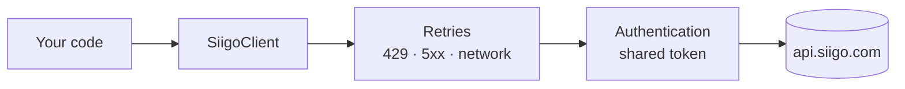

# SiigoSharp

[Español](https://github.com/MateoVH/SiigoDemo/blob/main/README.md) · **English**

[](https://github.com/MateoVH/SiigoDemo/actions/workflows/ci.yml)
[](https://dotnet.microsoft.com/)
[](https://github.com/MateoVH/SiigoDemo/blob/main/LICENSE)

An **unofficial** .NET client for the [Siigo Nube API](https://developers.siigo.com/docs/siigoapi/), the accounting and
electronic invoicing platform used by Colombian businesses. Connect your ERP, online store or custom system to Siigo in
a few lines, without wrestling with tokens, retries or error formats.

> Independent project, not affiliated with Siigo S.A.S. "Siigo" is a trademark of its respective owner.

## What it handles

| | |
|---|---|
| 🔐 **Automatic authentication** | Requests the token once and shares it across concurrent requests. Renews it in the background before it expires (24 h), without slowing your calls down, and also when Siigo rejects it. |
| 🧾 **Customers, products and invoices** | Create, read, look up by NIT or code, walk through every page with `await foreach`, download the PDF and e-mail the invoice. |
| 🔁 **Safe retries** | Exponential backoff with jitter on 429, 5xx and network failures, honoring `Retry-After`. Retries never duplicate documents: invoices carry an `Idempotency-Key`. |
| 🧮 **Totals computed like Siigo** | `InvoiceTotals` applies the rounding formula Siigo documents, so payments add up and you don't get `invalid_total_payments`. |
| 🚨 **Typed errors** | `SiigoApiException` with the HTTP status and Siigo's error list (`already_exists`, `invalid_reference`…). |
| 🌎 **Spanish and English** | Exceptions and logs in ES or EN with a single option. |
| 🧩 **Modern .NET** | `IHttpClientFactory`, dependency injection, `ILogger`, `IAsyncEnumerable` and nullable types, with no heavy dependencies. |

## Try the demo (no credentials needed)

```bash
git clone https://github.com/MateoVH/SiigoDemo.git
cd SiigoDemo
dotnet run --project samples/SiigoSharp.Demo -- --lang en
```

The demo emulates Siigo in memory and triggers real-world failures: a token that expires early, a 503 error, a
response lost right after the invoice is created, and the rate limit. You can watch the library handle each one:

```text
── 2 · Customer ────────────────────────────────────────────────────────
   🔄 Siigo rejected the access token on GET /v1/customers (HTTP 401); renewing it and repeating the request
   🔑 Siigo access token acquired; it expires on 2026-10-10 14:59:07Z
   ✅ Customer created: Ferretería El Tornillo SAS · NIT 900123456

── 4 · Sales invoice ───────────────────────────────────────────────────
   ⏳ POST /v1/invoices failed (HTTP 502); retry 1 of 4 in 1079 ms
╭─Invoice─────────────────────────────────────────╮
│ Invoice: FV-1-1001                              │
│ Subtotal: $900,000   IVA: $171,000              │
│ Total: $1,071,000                               │
│ DIAN status: not sent (draft)                   │
╰─────────────────────────────────────────────────╯

── ✅ Done ─────────────────────────────────────────────────────────────
   What SiigoSharp handled for you:
   🔑 1 token(s) renewed automatically
   ⏳ 3 retry(ies) after transient errors
   🧾 1 invoice(s) on the server: the lost response caused no duplicates
```

## Installation

```bash
dotnet add package SiigoSharp
```

Requires .NET 8 or later.

## Configuration

Siigo asks for three values:

- **Username**: the user enabled for the API (an e-mail address).
- **AccessKey**: the access key Siigo Nube generates for integrations.
- **PartnerId**: the name of your application, 3 to 100 letters or digits, without spaces. Siigo requires it on every request.

```json
{
  "Siigo": {
    "Username": "api@mycompany.com",
    "PartnerId": "MyIntegration",
    "Language": "English"
  }
}
```

Keep the `AccessKey` out of your code: in user-secrets, in environment variables (`Siigo__AccessKey`) or in a
secrets manager.

```bash
dotnet user-secrets set "Siigo:AccessKey" "<your-access-key>"
```

### With dependency injection (ASP.NET Core, Worker Service)

```csharp
builder.Services.AddSiigo(builder.Configuration.GetSection("Siigo"));
```

```csharp
public class BillingService(ISiigoClient siigo)
{
    public Task<Invoice> BillAsync(InvoiceRequest invoice) => siigo.Invoices.CreateAsync(invoice);
}
```

`ISiigoClient` is registered as a singleton and can be injected anywhere. Under the hood it asks
`IHttpClientFactory` for an `HttpClient` on each request, so connections keep being renewed. `AddSiigo` returns the
`IHttpClientBuilder` in case you need a proxy or your own handlers, and the options are validated when the
application starts.

> If your application adds `AddStandardResilienceHandler()` to every `HttpClient` (for example, the .NET Aspire
> ServiceDefaults), remove it from the Siigo client with `builder.Services.AddSiigo(...).RemoveAllResilienceHandlers();`.
> That policy repeats POSTs after 5xx errors, which can duplicate documents, and cuts calls off after 30 s, less than
> Siigo recommends. SiigoSharp already brings its own safe retries.

### Without dependency injection

```csharp
using var siigo = new SiigoClient(new SiigoClientOptions
{
    Username = "api@mycompany.com",
    AccessKey = Environment.GetEnvironmentVariable("SIIGO_ACCESS_KEY")!,
    PartnerId = "MyIntegration",
    Language = SiigoLanguage.English,
});
```

Create a single instance and reuse it: it is thread-safe and keeps the token.

## Examples

### Catalogs: the ids you need to invoice

```csharp
var invoiceTypes = await siigo.Catalogs.GetDocumentTypesAsync(DocumentTypeCodes.SalesInvoice); // "FV"
var taxes        = await siigo.Catalogs.GetTaxesAsync();
var paymentTypes = await siigo.Catalogs.GetPaymentTypesAsync(DocumentTypeCodes.SalesInvoice);
var sellers      = await siigo.Catalogs.GetUsersAsync();
var groups       = await siigo.Catalogs.GetAccountGroupsAsync();

var electronicInvoice = invoiceTypes.First(type => type.Active == true);
var vat19 = taxes.First(tax => tax.Type == TaxTypes.Iva && tax.Percentage == 19);
```

Catalogs rarely change, so they are worth caching.

### Customers

```csharp
var customer = await siigo.Customers.FindByIdentificationAsync("900123456")
    ?? await siigo.Customers.CreateAsync(new CustomerRequest
    {
        PersonType = PersonType.Company,
        IdType = IdTypes.Nit,
        Identification = "900123456",
        Name = ["Ferretería El Tornillo SAS"],             // A person: ["First names", "Last names"]
        FiscalResponsibilities = [FiscalResponsibility.NoResponsable],
        Address = new Address { Street = "Carrera 43A # 1-50", City = City.Colombia("05", "05001") }, // Medellín
        Contacts = [new Contact { FirstName = "Laura", LastName = "Gómez", Email = "facturas@eltornillo.example" }],
    });
```

`UpdateAsync` replaces the whole customer: Siigo empties the fields you leave out.

### Products

```csharp
var product = await siigo.Products.FindByCodeAsync("TORN-001")
    ?? await siigo.Products.CreateAsync(new ProductRequest
    {
        Code = "TORN-001",
        Name = "Drywall screw 6 x 1",
        AccountGroup = groups.First().Id,
        Taxes = [new IdReference(vat19.Id)],
        Prices = [ProductPrice.Create(350m)],              // Price list 1, in COP
    });
```

### Sales invoices

```csharp
List<InvoiceItemRequest> items =
[
    new() { Code = "TORN-001", Quantity = 100, Price = 350m, Taxes = [new IdReference(vat19.Id)] },
];

// The payments must equal the total Siigo computes, with its rounding.
var totals = InvoiceTotals.Calculate(items, taxes, electronicInvoice);

var invoice = await siigo.Invoices.CreateAsync(new InvoiceRequest
{
    Document = new IdReference(electronicInvoice.Id),
    Date = DateOnly.FromDateTime(DateTime.Today),
    Customer = new InvoiceCustomerReference { Identification = "900123456" },
    Seller = sellers.First().Id,
    Items = items,
    Payments = [new InvoicePaymentRequest { Id = paymentTypes.First().Id, Value = totals.Total }],
    SendToDian = false,                                    // true sends it to the DIAN on creation
    IdempotencyKey = $"Order{order.Number}",               // Optional; see "Safe retries"
});

Console.WriteLine($"{invoice.Name}: {invoice.Total} ({invoice.Stamp?.Status})");

byte[] pdf = await siigo.Invoices.GetPdfAsync(invoice.Id!);
await siigo.Invoices.SendByEmailAsync(invoice.Id!, "facturas@eltornillo.example");
```

`InvoiceTotals` covers IVA and Impoconsumo taxes with discounts given as values. With withholdings, or when the
document type expresses discounts as percentages, it throws `NotSupportedException` instead of guessing a rounding
Siigo does not document.

> ⚠️ `SendToDian = true` issues an electronic invoice that is legally valid before the DIAN, Colombia's tax
> authority. Run your tests in a test company, which you can request from Siigo's support.

### Walking through every record

```csharp
await foreach (var customer in siigo.Customers.ListAllAsync(new CustomerQuery { UpdatedStart = lastSync }))
{
    // Pages are requested as you go.
}
```

### Error handling

```csharp
try
{
    await siigo.Customers.CreateAsync(newCustomer);
}
catch (SiigoApiException ex) when (ex.HasErrorCode("already_exists"))
{
    // The NIT is already registered in Siigo.
}
catch (SiigoApiException ex)
{
    foreach (var error in ex.Errors)
    {
        Console.WriteLine($"{error.Code}: {error.Message} ({string.Join(", ", error.Params)})");
    }
}
```

| Exception | When |
|---|---|
| `SiigoAuthenticationException` | Siigo rejected the `Username`, `AccessKey` or `PartnerId`. |
| `SiigoApiException` | Siigo answered 4xx/5xx. Exposes `StatusCode`, `Errors`, `ResponseBody` and `RetryAfter`. |
| `SiigoException` | The response could not be read. |
| `OptionsValidationException` | An option is missing or invalid (validated when the client is built). |
| `HttpRequestException` / `TaskCanceledException` | Network failure or timeout. |

### Message language (ES / EN)

```csharp
options.Language = SiigoLanguage.English; // Default: SiigoLanguage.Spanish
```

```text
Siigo respondió HTTP 400 BadRequest a POST /v1/customers. [already_exists] The identification already exists (identification)
Siigo returned HTTP 400 BadRequest for POST /v1/customers. [already_exists] The identification already exists (identification)
```

The language applies to exceptions, option validation and logs. The text of each Siigo error (`error.Message`) is
shown as Siigo sends it. In logs, the `EventId`s and the structured property names are the same in both languages, so
your queries and alerts do not change.

## Safe retries



| Situation | GET / PUT / DELETE | Create invoice (with `Idempotency-Key`) | Other POSTs |
|---|:-:|:-:|:-:|
| 429 rate limit · 408 | ✅ | ✅ | ✅ |
| 500 · 502 · 503 · 504 | ✅ | ✅ | ❌ |
| Network failure **before** sending (DNS, connection, TLS) | ✅ | ✅ | ✅ |
| Network failure **after** sending | ✅ | ✅ | ❌ |
| 401 (expired or revoked token) | Renews the token and repeats once | ← | ← |

- **Why aren't other POSTs repeated?** After a 5xx the record may already exist; sending it again could duplicate it.
- **Why is the invoice repeated?** It carries an `Idempotency-Key`. When Siigo receives a key it already processed, it
  returns the invoice it created instead of creating another one. The library generates a key per call; use your own
  (for example, your order number) to retry safely even after a timeout or an application restart.
- Siigo allows **100 requests per minute** per company (**10** for test companies) and does not document `Retry-After`,
  so the defaults spread 4 retries over about 30 seconds. If Siigo sends a `Retry-After` longer than `MaxDelay`, the
  error is returned without blocking the caller, with the suggested wait in `ex.RetryAfter`.

## Options

| Option | Default | Description |
|---|---|---|
| `Username` | — | API user. |
| `AccessKey` | — | Access key. |
| `PartnerId` | — | Name of your application (`Partner-Id` header). |
| `BaseAddress` | `https://api.siigo.com/` | API address (useful behind a proxy). |
| `Language` | `Spanish` | Language of exceptions and logs: `Spanish` or `English`. |
| `Timeout` | 120 s | Maximum duration of a call, retries included (Siigo recommends at least 120 s). |
| `TokenRefreshMargin` | 5 min | How long before its expiration the token is renewed, in the background. |
| `Retry:MaxRetries` | 4 | Retries after the first attempt (0 disables them). |
| `Retry:BaseDelay` | 2 s | Wait before the first retry; it doubles on each retry (±20%). |
| `Retry:MaxDelay` | 30 s | Longest wait between attempts. |

## Logging

The library writes to `ILogger` under the `SiigoSharp.Authentication` and `SiigoSharp.Http` categories: tokens
acquired, failed renewals, tokens rejected and retries. It never logs credentials, tokens or query strings, which may
contain national ID or NIT numbers.

```json
{ "Logging": { "LogLevel": { "SiigoSharp": "Warning" } } }
```

With dependency injection, `AddSiigo` turns off `IHttpClientFactory`'s default logs for this client: they include the
full URL, with NIT or ID numbers, and at Trace level the headers. If you still want them, add them back with
`.AddDefaultLogger()` on the builder `AddSiigo` returns.

## Testing your code

Depend on `ISiigoClient`: each resource is an interface (`ICustomersClient`, `IInvoicesClient`…) that is easy to
replace with a test double. To test at the HTTP level, pass your own `HttpMessageHandler` to
`new SiigoClient(options, handler)`.

## Demo against your Siigo company

```bash
cd samples/SiigoSharp.Demo
dotnet user-secrets set "Siigo:Username" "api@mycompany.com"
dotnet user-secrets set "Siigo:AccessKey" "<your-access-key>"
dotnet user-secrets set "Siigo:PartnerId" "MyIntegration"
dotnet run -- --real --lang en
```

The demo asks for confirmation before creating data and does not send the invoice to the DIAN. Use a test company.

## Repository layout

```text
src/SiigoSharp/            The library
tests/SiigoSharp.Tests/    Automated tests (xUnit v3, on .NET 8 and .NET 10)
samples/SiigoSharp.Demo/   Console demo (Spectre.Console) with simulated and real modes
```

```bash
dotnet build
dotnet test
```

## Roadmap

- Credit notes, cash receipts and journal vouchers.
- Webhooks.
- .NET Framework support (netstandard2.0).
- Distributed token cache for applications running several instances.

Ideas or bugs? Open an issue or a pull request.

## License

[MIT](https://github.com/MateoVH/SiigoDemo/blob/main/LICENSE) © Mateo Vergara Henao
