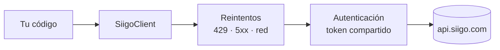

# SiigoSharp

**Español** · [English](https://github.com/MateoVH/SiigoDemo/blob/main/README.en.md)

[](https://github.com/MateoVH/SiigoDemo/actions/workflows/ci.yml)
[](https://dotnet.microsoft.com/)
[](https://github.com/MateoVH/SiigoDemo/blob/main/LICENSE)

Cliente .NET **no oficial** para la [API de Siigo Nube](https://developers.siigo.com/docs/siigoapi/). Conecta tu ERP,
tienda en línea o sistema a la medida con Siigo en pocas líneas, sin pelear con tokens, reintentos ni formatos de error.

> Proyecto independiente, sin relación con Siigo S.A.S. «Siigo» es una marca de su respectivo titular.

## Qué resuelve

| | |
|---|---|
| 🔐 **Autenticación automática** | Pide el token una sola vez y lo comparte entre peticiones concurrentes. Lo renueva en segundo plano antes de que venza (24 h), sin frenar tus llamadas, y también cuando Siigo lo rechaza. |
| 🧾 **Clientes, productos y facturas** | Crear, consultar, buscar por NIT o código, recorrer todas las páginas con `await foreach`, descargar el PDF y enviar la factura por correo. |
| 🔁 **Reintentos seguros** | Backoff exponencial con *jitter* ante 429, 5xx y fallas de red, respetando `Retry-After`. Los reintentos nunca duplican documentos: las facturas viajan con `Idempotency-Key`. |
| 🧮 **Totales como los calcula Siigo** | `InvoiceTotals` aplica la fórmula de redondeo documentada por Siigo para que los pagos cuadren y no recibas `invalid_total_payments`. |
| 🚨 **Errores tipados** | `SiigoApiException` con el código HTTP y los errores de Siigo (`already_exists`, `invalid_reference`…). |
| 🌎 **Español e inglés** | Excepciones y logs en ES o EN con una sola opción. |
| 🧩 **.NET moderno** | `IHttpClientFactory`, inyección de dependencias, `ILogger`, `IAsyncEnumerable` y tipos *nullable*, sin dependencias pesadas. |

## Prueba la demo (sin credenciales)

```bash
git clone https://github.com/MateoVH/SiigoDemo.git
cd SiigoDemo
dotnet run --project samples/SiigoSharp.Demo
```

Agrega `-- --lang en` para verla en inglés. La demo emula Siigo en memoria y provoca fallas reales: un token que vence
antes de tiempo, un error 503, una respuesta que se pierde justo después de crear la factura y el límite de peticiones.
Así se ve a la librería resolverlas sola:

```text
── 2 · Cliente ─────────────────────────────────────────────────────────
   🔄 Siigo rechazó el token de acceso en GET /v1/customers (HTTP 401); se renueva y se repite la petición
   🔑 Token de acceso de Siigo obtenido; vence el 2026-10-10 14:58:52Z
   ✅ Cliente creado: Ferretería El Tornillo SAS · NIT 900123456

── 4 · Factura de venta ────────────────────────────────────────────────
   ⏳ POST /v1/invoices falló (HTTP 502); reintento 1 de 4 en 922 ms
╭─Factura─────────────────────────────────────────╮
│ Factura: FV-1-1001                              │
│ Subtotal: $900.000   IVA: $171.000              │
│ Total: $1.071.000                               │
│ Estado DIAN: no enviada (borrador)              │
╰─────────────────────────────────────────────────╯

── ✅ Listo ────────────────────────────────────────────────────────────
   Lo que SiigoSharp resolvió por usted:
   🔑 1 token(s) renovado(s) automáticamente
   ⏳ 3 reintento(s) ante errores temporales
   🧾 1 factura(s) en el servidor: la respuesta perdida no generó duplicados
```

## Instalación

```bash
dotnet add package SiigoSharp
```

Requiere .NET 8 o superior.

## Configuración

Siigo pide tres datos:

- **Username**: el usuario habilitado para la API (un correo).
- **AccessKey**: la llave de acceso que genera Siigo Nube para integraciones.
- **PartnerId**: el nombre de tu aplicación, de 3 a 100 letras o números, sin espacios. Siigo lo exige en todas las peticiones.

```json
{
  "Siigo": {
    "Username": "api@miempresa.com",
    "PartnerId": "MiIntegracion",
    "Language": "Spanish"
  }
}
```

Guarda la `AccessKey` fuera del código: en *user-secrets*, en variables de entorno (`Siigo__AccessKey`) o en un
gestor de secretos.

```bash
dotnet user-secrets set "Siigo:AccessKey" "<tu-access-key>"
```

### Con inyección de dependencias (ASP.NET Core, Worker Service)

```csharp
builder.Services.AddSiigo(builder.Configuration.GetSection("Siigo"));
```

```csharp
public class FacturacionService(ISiigoClient siigo)
{
    public Task<Invoice> FacturarAsync(InvoiceRequest factura) => siigo.Invoices.CreateAsync(factura);
}
```

`ISiigoClient` se registra como *singleton* y puede inyectarse en cualquier servicio. Por debajo pide un
`HttpClient` a `IHttpClientFactory` en cada petición, así que las conexiones se renuevan. `AddSiigo` devuelve el
`IHttpClientBuilder` por si necesitas un proxy o *handlers* propios, y las opciones se validan al iniciar la aplicación.

> Si tu aplicación agrega `AddStandardResilienceHandler()` a todos los `HttpClient` (por ejemplo, los *ServiceDefaults*
> de .NET Aspire), quítalo del cliente de Siigo con `builder.Services.AddSiigo(...).RemoveAllResilienceHandlers();`.
> Esa política repite los POST tras errores 5xx, lo que puede duplicar documentos, y corta las llamadas a los 30 s,
> menos de lo que Siigo recomienda. SiigoSharp ya trae sus propios reintentos seguros.

### Sin inyección de dependencias

```csharp
using var siigo = new SiigoClient(new SiigoClientOptions
{
    Username = "api@miempresa.com",
    AccessKey = Environment.GetEnvironmentVariable("SIIGO_ACCESS_KEY")!,
    PartnerId = "MiIntegracion",
});
```

Crea una sola instancia y reutilízala: es *thread-safe* y conserva el token.

## Ejemplos

### Catálogos: los IDs que necesitas para facturar

```csharp
var tiposFactura = await siigo.Catalogs.GetDocumentTypesAsync(DocumentTypeCodes.SalesInvoice); // "FV"
var impuestos    = await siigo.Catalogs.GetTaxesAsync();
var formasPago   = await siigo.Catalogs.GetPaymentTypesAsync(DocumentTypeCodes.SalesInvoice);
var vendedores   = await siigo.Catalogs.GetUsersAsync();
var grupos       = await siigo.Catalogs.GetAccountGroupsAsync();

var facturaElectronica = tiposFactura.First(tipo => tipo.Active == true);
var iva19 = impuestos.First(impuesto => impuesto.Type == TaxTypes.Iva && impuesto.Percentage == 19);
```

Los catálogos cambian poco, así que vale la pena guardarlos en caché.

### Clientes

```csharp
var cliente = await siigo.Customers.FindByIdentificationAsync("900123456")
    ?? await siigo.Customers.CreateAsync(new CustomerRequest
    {
        PersonType = PersonType.Company,
        IdType = IdTypes.Nit,
        Identification = "900123456",
        Name = ["Ferretería El Tornillo SAS"],             // Persona natural: ["Nombres", "Apellidos"]
        FiscalResponsibilities = [FiscalResponsibility.NoResponsable],
        Address = new Address { Street = "Carrera 43A # 1-50", City = City.Colombia("05", "05001") }, // Medellín
        Contacts = [new Contact { FirstName = "Laura", LastName = "Gómez", Email = "facturas@eltornillo.example" }],
    });
```

`UpdateAsync` reemplaza el cliente completo: en Siigo se vacían los campos que no envíes.

### Productos

```csharp
var producto = await siigo.Products.FindByCodeAsync("TORN-001")
    ?? await siigo.Products.CreateAsync(new ProductRequest
    {
        Code = "TORN-001",
        Name = "Tornillo drywall 6 x 1",
        AccountGroup = grupos.First().Id,
        Taxes = [new IdReference(iva19.Id)],
        Prices = [ProductPrice.Create(350m)],              // Lista de precios 1, en COP
    });
```

### Facturas de venta

```csharp
List<InvoiceItemRequest> items =
[
    new() { Code = "TORN-001", Quantity = 100, Price = 350m, Taxes = [new IdReference(iva19.Id)] },
];

// El valor de los pagos debe ser igual al total que calcula Siigo, con su redondeo.
var totales = InvoiceTotals.Calculate(items, impuestos, facturaElectronica);

var factura = await siigo.Invoices.CreateAsync(new InvoiceRequest
{
    Document = new IdReference(facturaElectronica.Id),
    Date = DateOnly.FromDateTime(DateTime.Today),
    Customer = new InvoiceCustomerReference { Identification = "900123456" },
    Seller = vendedores.First().Id,
    Items = items,
    Payments = [new InvoicePaymentRequest { Id = formasPago.First().Id, Value = totales.Total }],
    SendToDian = false,                                    // true la envía a la DIAN al crearla
    IdempotencyKey = $"Pedido{pedido.Numero}",             // Opcional; ver «Reintentos seguros»
});

Console.WriteLine($"{factura.Name}: {factura.Total} ({factura.Stamp?.Status})");

byte[] pdf = await siigo.Invoices.GetPdfAsync(factura.Id!);
await siigo.Invoices.SendByEmailAsync(factura.Id!, "facturas@eltornillo.example");
```

`InvoiceTotals` cubre los impuestos IVA e Impoconsumo con descuentos en valor. Si hay retenciones, o si el tipo de
documento expresa los descuentos en porcentaje, lanza `NotSupportedException` en lugar de adivinar un redondeo que
Siigo no documenta.

> ⚠️ `SendToDian = true` emite una factura electrónica con validez ante la DIAN. Haz tus pruebas en una empresa de
> pruebas, que se solicita al soporte de Siigo.

### Recorrer todos los registros

```csharp
await foreach (var cliente in siigo.Customers.ListAllAsync(new CustomerQuery { UpdatedStart = ultimaSincronizacion }))
{
    // Las páginas se piden a medida que avanzas.
}
```

### Manejo de errores

```csharp
try
{
    await siigo.Customers.CreateAsync(nuevoCliente);
}
catch (SiigoApiException ex) when (ex.HasErrorCode("already_exists"))
{
    // El NIT ya está registrado en Siigo.
}
catch (SiigoApiException ex)
{
    foreach (var error in ex.Errors)
    {
        Console.WriteLine($"{error.Code}: {error.Message} ({string.Join(", ", error.Params)})");
    }
}
```

| Excepción | Cuándo |
|---|---|
| `SiigoAuthenticationException` | Siigo rechazó `Username`, `AccessKey` o `PartnerId`. |
| `SiigoApiException` | Siigo respondió 4xx/5xx. Expone `StatusCode`, `Errors`, `ResponseBody` y `RetryAfter`. |
| `SiigoException` | La respuesta no se pudo leer. |
| `OptionsValidationException` | Falta una opción o es inválida (se valida al construir el cliente). |
| `HttpRequestException` / `TaskCanceledException` | Falla de red o tiempo de espera agotado. |

### Idioma de los mensajes (ES / EN)

```csharp
options.Language = SiigoLanguage.English; // Por defecto: SiigoLanguage.Spanish
```

```text
Siigo respondió HTTP 400 BadRequest a POST /v1/customers. [already_exists] The identification already exists (identification)
Siigo returned HTTP 400 BadRequest for POST /v1/customers. [already_exists] The identification already exists (identification)
```

El idioma aplica a las excepciones, a la validación de opciones y a los logs. El texto de cada error de Siigo
(`error.Message`) se muestra tal como lo envía Siigo. En los logs, los `EventId` y los nombres de las propiedades
estructuradas son los mismos en ambos idiomas, así que tus consultas y alertas no cambian.

## Reintentos seguros



| Situación | GET / PUT / DELETE | Crear factura (con `Idempotency-Key`) | Otros POST |
|---|:-:|:-:|:-:|
| 429 límite de peticiones · 408 | ✅ | ✅ | ✅ |
| 500 · 502 · 503 · 504 | ✅ | ✅ | ❌ |
| Falla de red **antes** de enviar (DNS, conexión, TLS) | ✅ | ✅ | ✅ |
| Falla de red **después** de enviar | ✅ | ✅ | ❌ |
| 401 (token vencido o revocado) | Renueva el token y repite una vez | ← | ← |

- **¿Por qué no se repiten los otros POST?** Tras un 5xx el registro pudo haberse creado; repetirlo podría duplicarlo.
- **¿Por qué la factura sí?** Viaja con un `Idempotency-Key`. Si Siigo recibe la misma clave, devuelve la factura que
  ya creó en lugar de crear otra. La librería genera una clave por llamada; usa la tuya (por ejemplo, el número de
  pedido) para reintentar con seguridad incluso después de un *timeout* o de reiniciar tu aplicación.
- Siigo permite **100 peticiones por minuto** por empresa (**10** en empresas de prueba) y no documenta `Retry-After`.
  Por eso los valores por defecto reparten 4 reintentos en unos 30 segundos. Si Siigo envía un `Retry-After` mayor que
  `MaxDelay`, se devuelve el error sin bloquear al llamador, con la espera sugerida en `ex.RetryAfter`.

## Opciones

| Opción | Por defecto | Descripción |
|---|---|---|
| `Username` | — | Usuario de la API. |
| `AccessKey` | — | Llave de acceso. |
| `PartnerId` | — | Nombre de tu aplicación (encabezado `Partner-Id`). |
| `BaseAddress` | `https://api.siigo.com/` | Dirección de la API (útil para un proxy). |
| `Language` | `Spanish` | Idioma de excepciones y logs: `Spanish` o `English`. |
| `Timeout` | 120 s | Duración máxima de una llamada, incluidos los reintentos (Siigo recomienda al menos 120 s). |
| `TokenRefreshMargin` | 5 min | Cuánto antes de su vencimiento se renueva el token, en segundo plano. |
| `Retry:MaxRetries` | 4 | Reintentos después del primer intento (0 los desactiva). |
| `Retry:BaseDelay` | 2 s | Espera antes del primer reintento; se duplica en cada uno (±20 %). |
| `Retry:MaxDelay` | 30 s | Espera máxima entre intentos. |

## Logs

La librería escribe en `ILogger` con las categorías `SiigoSharp.Authentication` y `SiigoSharp.Http`: tokens obtenidos,
renovaciones fallidas, tokens rechazados y reintentos. Nunca registra credenciales, tokens ni parámetros de consulta,
que pueden contener cédulas o NIT.

```json
{ "Logging": { "LogLevel": { "SiigoSharp": "Warning" } } }
```

Con inyección de dependencias, `AddSiigo` desactiva para este cliente los logs por defecto de `IHttpClientFactory`:
incluyen la URL completa, con NIT o cédula, y en nivel *Trace* los encabezados. Si aun así los necesitas, agrégalos con
`.AddDefaultLogger()` sobre el *builder* que devuelve `AddSiigo`.

## Pruebas de tu código

Depende de `ISiigoClient`: cada recurso es una interfaz (`ICustomersClient`, `IInvoicesClient`…) fácil de reemplazar
por un doble de prueba. Para probar a nivel HTTP, pasa tu propio `HttpMessageHandler` a
`new SiigoClient(options, handler)`.

## Demo con tu empresa de Siigo

```bash
cd samples/SiigoSharp.Demo
dotnet user-secrets set "Siigo:Username" "api@miempresa.com"
dotnet user-secrets set "Siigo:AccessKey" "<tu-access-key>"
dotnet user-secrets set "Siigo:PartnerId" "MiIntegracion"
dotnet run -- --real
```

La demo pide confirmación antes de crear datos y no envía la factura a la DIAN. Usa una empresa de pruebas.

## Estructura del repositorio

```text
src/SiigoSharp/            La librería
tests/SiigoSharp.Tests/    Pruebas automatizadas (xUnit v3, en .NET 8 y .NET 10)
samples/SiigoSharp.Demo/   Demo de consola (Spectre.Console) con modo simulado y modo real
```

```bash
dotnet build
dotnet test
```

## Hoja de ruta

- Notas crédito, recibos de caja y comprobantes contables.
- Webhooks.
- Soporte para .NET Framework (netstandard2.0).
- Caché distribuida del token para aplicaciones con varias instancias.

¿Ideas o errores? Abre un *issue* o un *pull request*.

## Licencia

[MIT](https://github.com/MateoVH/SiigoDemo/blob/main/LICENSE) © Mateo Vergara Henao
